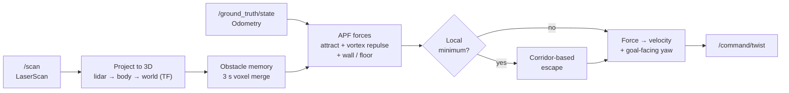

# APF-Nav: Artificial Potential Field Navigator

**Lidar-based 3D obstacle avoidance for a quadrotor in ROS Noetic and Gazebo.**

[](http://wiki.ros.org/noetic)
[](https://releases.ubuntu.com/focal/)
[](https://classic.gazebosim.org/)
[](https://www.python.org/)

APF-Nav flies a [hector quadrotor](https://github.com/tu-darmstadt-ros-pkg/hector_quadrotor)
through a sequence of waypoints in a 30 x 30 m indoor hangar with box
obstacles. The drone uses only a 270° Hokuyo UTM-30LX lidar and its pose; there
is no prior map. Each waypoint pulls the drone towards it, and every obstacle
the lidar sees pushes it away. The sum of these forces becomes the velocity
command.

<p align="center">
  <a href="docs/media/apf_mission.mp4">
    
  </a>
  <br>
  <em>A full mission in Gazebo: 10 waypoints, no collisions. GIF at 16x real time; click for the MP4 at 4x.</em>
</p>

---

## Contents

- [Features](#features)
- [How it works](#how-it-works)
- [Results](#results)
- [Repository layout](#repository-layout)
- [Installation](#installation)
- [Usage](#usage)
- [Configuration](#configuration)
- [ROS interface](#ros-interface)
- [Known limitations](#known-limitations)
- [Acknowledgements](#acknowledgements)

## Features

- **3D artificial potential field**: attraction to the waypoint, plus repulsion
  from lidar points, walls and the floor.
- **Vortex repulsion**: a sideways component steers the drone *around*
  obstacles instead of stopping in front of them.
- **Adaptive gains**: repulsion grows near obstacles (up to 3x), and attraction
  is softened close to the goal so the drone doesn't overshoot.
- **Local-minimum escape**: the node detects when the drone is stuck between
  obstacles, picks the side with a free corridor and commits to an escape
  manoeuvre. It gives up on a waypoint after a set number of escapes or a
  timeout, and reports it.
- **Obstacle memory**: lidar points are kept for 3 s, so obstacles stay known
  while they are in the lidar's 90° blind sector.
- **Goal-facing heading**: the drone yaws towards the waypoint so the lidar
  looks where it is going. Speed is limited when the drone moves into the blind
  sector.
- **Correct lidar geometry**: the full lidar-to-body transform is read from TF,
  including the hector quadrotor's **upside-down** Hokuyo mount, which mirrors
  the scan.
- **Safety**: the drone hovers if the scan goes stale, and RViz markers show
  the forces and waypoints.

## How it works



On each control tick (10 Hz):

1. **Perception**: lidar rays are projected into the world frame using the
   lidar-to-body transform from TF and the drone's pose. Floor hits are
   dropped, and the points are merged with the last 3 s of scans.
2. **Forces**:
   - Attraction: `F_att = k_att · (goal − p)`, capped.
   - Repulsion from each point inside the influence radius, with a tangential
     (vortex) term.
   - Separate short-range repulsion from the room walls and the floor.
3. **Gain tuning**: the gains are rescaled based on the distance to the closest
   obstacle and to the goal.
4. **Local minima**: if recent progress towards the goal stalls, the drone
   escapes sideways towards the freer side. It returns to normal APF only once
   the straight path to the goal is clear.
5. **Command**: the force is turned into a velocity, limited to
   `v_max` / `vz_max`, and published as a world-frame `TwistStamped` with a yaw
   rate that turns the drone towards the goal.

## Results

Measured in Gazebo 11 headless, with the default parameters and the 10-waypoint
mission in `room_6x6.world`:

| Navigator | Waypoints reached | Collisions | Mission time (sim) | Notes |
|---|---|---|---|---|
| APF (`apf_navigator.py`) | 10 / 10 in 4 consecutive runs | 0 | ≈ 385 s | Closest lidar range 1.35 m; max tilt 3.5° |
| Rule-based (`dwa_inspection.py`) | 10 / 10 | 0 | ≈ 150 s | Takes off, flies the mission and lands |

## Repository layout

```
.
├── dependencies.repos          # upstream packages fetched with vcstool
├── docs/media/                 # demo GIF and video
└── src/
    ├── my_room_world/          # world, launch files and navigation nodes
    │   ├── launch/             # room.launch, apf_navigation.launch, ...
    │   ├── worlds/             # room_6x6.world (30 x 30 m hangar)
    │   └── scripts/
    │       ├── apf_navigator.py      # APF navigator (main node)
    │       ├── dwa_inspection.py     # rule-based state-machine navigator
    │       ├── lawnmower_pose.py     # POI lawnmower survey
    │       ├── mapping_supervisor.py # RTAB-Map start / stop / save
    │       └── test.py               # lidar orientation check
    ├── dwa_rubi/dwa_rubi/      # 3D DWA follower on an RTAB-Map point cloud
    ├── my_hector_addons/       # extra sensor xacros (360° lidar, RGB-D, stereo)
    └── adaptive_dwa_ros/       # placeholder package
```

## Installation

**Requirements:** Ubuntu 20.04, ROS Noetic (`ros-noetic-desktop-full`) and
Gazebo 11.

```bash
sudo apt install python3-vcstool python3-catkin-tools \
                 ros-noetic-hector-gazebo-plugins ros-noetic-rtabmap-ros

mkdir -p ~/apf_ws && cd ~/apf_ws
git clone https://github.com/UnknownEng/APF-Nav_Artificial_Potential_Field_Navigator-.git .
vcs import src < dependencies.repos
rosdep install --from-paths src --ignore-src -y -r
catkin build            # or: catkin_make

echo "source ~/apf_ws/devel/setup.bash" >> ~/.bashrc
source ~/.bashrc
```

<details>
<summary><b>Windows 11 (WSL2)</b></summary>

ROS Noetic runs in WSL2. Gazebo windows appear on the Windows desktop through
WSLg.

```powershell
wsl --install -d Ubuntu-20.04
```

Open *Ubuntu 20.04* from the Start menu, install
[ROS Noetic](http://wiki.ros.org/noetic/Installation/Ubuntu), then follow the
steps above. Rendering is slower than on native Linux, but the navigation runs
on simulation time, so the results are the same.
</details>

## Usage

### APF navigator

```bash
# Terminal 1: Gazebo world, quadrotor and the APF node
roslaunch my_room_world apf_navigation.launch          # add gui:=false for headless

# Terminal 2: start the motors; the mission then runs on its own
rosservice call /enable_motors "enable: true"
```

The node logs each waypoint (`APF: Waypoint 3/10 reached!`) and ends with
`Mission complete! All waypoints reached.`

### Rule-based navigator

```bash
roslaunch my_room_world room.launch
rosrun my_room_world dwa_inspection.py
```

### DWA follower (experimental)

```bash
roslaunch dwa_rubi dwa_follower.launch
rosrun my_room_world lawnmower_pose.py _pose_topic:=/dwa/goal
```

The follower reads waypoints on `/dwa/goal` and obstacles from
`/rtabmap/cloud_map`. It needs a depth camera feeding RTAB-Map (see
[Known limitations](#known-limitations)).

## Configuration

Main parameters of `apf_navigator.py`. Set them in `apf_navigation.launch` or
with `_param:=value`.

| Parameter | Default | Description |
|---|---|---|
| `v_max` / `vz_max` | `0.3` / `0.3` | Horizontal / vertical speed limit (m/s) |
| `attraction_gain` | `0.6` | Pull towards the waypoint |
| `repulsion_gain` | `1.0` | Repulsion in open space; ramps up to 3x near obstacles |
| `goal_tol_xy` / `goal_tol_z` | `0.6` / `0.4` | Waypoint acceptance radius (m) |
| `heading_mode` | `goal` | `goal`: face the waypoint · `travel`: face the velocity · `fixed`: never yaw |
| `obstacle_memory` | `3.0` | Seconds that lidar points are remembered |
| `wp_timeout` | `120` | Skip (and report) a waypoint after this many seconds |
| `max_escapes_per_wp` | `6` | Skip (and report) a waypoint after this many escapes |
| `scan_timeout` | `1.0` | Hover if no scan arrives within this time (s) |
| `scan_yaw_offset` | *unset* | Manual override for an **upright** lidar only; the mount is normally read from TF |

## ROS interface

| Direction | Topic / service | Type |
|---|---|---|
| Subscribes | `/scan` | `sensor_msgs/LaserScan` |
| Subscribes | `/ground_truth/state` | `nav_msgs/Odometry` |
| Publishes | `/command/twist` | `geometry_msgs/TwistStamped` (world frame) |
| Publishes | `/apf/markers` | `visualization_msgs/MarkerArray` (forces, waypoints) |
| Uses | TF `laser0_frame → base_link` | lidar mount transform |

> **Lidar mount:** the hector quadrotor's Hokuyo is mounted upside down
> (`rpy="π 0 0"`), which mirrors the scan left/right. Both lidar navigators read
> the full transform from TF and log the detected mount at start-up, for
> example `mount: UPSIDE DOWN (scan mirrored)`.

## Known limitations

- **Pose source**: the drone uses Gazebo ground truth, so there is no state
  estimation in the loop.
- **Lidar coverage**: the lidar is a single 2D plane, so obstacles above or
  below the scan plane are only seen once the drone's altitude brings them into
  it.
- **DWA pipeline**: no launch file spawns a depth camera for RTAB-Map yet, so
  the DWA follower has not been tested end to end.
- **Missing models**: the world references stairs and scissor-lift meshes that
  are not in this repository, so those obstacles do not appear in Gazebo.

## Acknowledgements

- [hector_quadrotor](https://github.com/tu-darmstadt-ros-pkg/hector_quadrotor), [hector_models](https://github.com/tu-darmstadt-ros-pkg/hector_models) and [hector_localization](https://github.com/tu-darmstadt-ros-pkg/hector_localization) (TU Darmstadt): quadrotor model, controllers and Gazebo plugins
- [realsense_ros_gazebo](https://github.com/nilseuropa/realsense_ros_gazebo): RealSense camera simulation
- [RTAB-Map](http://introlab.github.io/rtabmap/): RGB-D mapping used by the DWA pipeline
