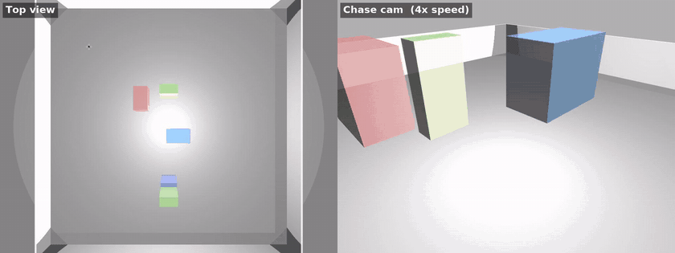

# APF-Nav: Artificial Potential Field navigator (ROS Noetic + Gazebo)

Hector quadrotor flying waypoints through a 30 x 30 m hangar-style room
(`my_room_world/worlds/room_6x6.world`), using a 270 deg Hokuyo UTM-30LX lidar
and Gazebo ground-truth pose.

## Demo

[](docs/media/apf_mission.mp4)

Full APF mission in Gazebo: all 10 waypoints reached with no collisions,
including the escape around the two touching boxes. The GIF runs at 16x real
time; click it for the [MP4](docs/media/apf_mission.mp4) at 4x.

## Packages

| Package | Contents |
|---|---|
| `my_room_world` | World, launch files and nodes: `apf_navigator.py` (APF), `dwa_inspection.py` (rule-based state machine), `lawnmower_pose.py` (POI survey), `mapping_supervisor.py` (RTAB-Map start/stop/save), `test.py` (lidar orientation check) |
| `dwa_rubi` (`src/dwa_rubi/dwa_rubi`) | `obstacle_avoidance.py`: 3D DWA follower on an RTAB-Map point cloud |
| `my_hector_addons` | Extra sensor xacros (360 lidar, RGB-D, stereo) |
| `adaptive_dwa_ros` | Placeholder (test node + RViz config) |

## Setup

```bash
sudo apt install python3-vcstool ros-noetic-hector-gazebo-plugins ros-noetic-rtabmap-ros
cd <workspace>
vcs import src < dependencies.repos
rosdep install --from-paths src --ignore-src -y
catkin build   # or catkin_make
source devel/setup.bash
```

### Windows (WSL2)

ROS Noetic needs Ubuntu 20.04. On Windows 11, install it as a WSL distro
(`wsl --install -d Ubuntu-20.04`), install `ros-noetic-desktop-full`, then
follow the steps above inside it. WSLg shows the Gazebo window on the Windows
desktop. Add the ROS and workspace `source` lines to `~/.bashrc` so every new
terminal is ready.

## Run

APF navigator (terminal 1 starts Gazebo, terminal 2 starts the mission):

```bash
roslaunch my_room_world apf_navigation.launch
```

```bash
rosservice call /enable_motors "enable: true"
```

The drone takes off and flies all waypoints on its own (about 6.5 min of
simulated time). Add `gui:=false` to the launch to run without the Gazebo
window.

Rule-based navigator: `roslaunch my_room_world room.launch`, then
`rosrun my_room_world dwa_inspection.py`.

DWA follower: `roslaunch dwa_rubi dwa_follower.launch` with waypoints on
`/dwa/goal` (not `/command/pose`, which the position controller uses) and a
point cloud on `/rtabmap/cloud_map`.

## Lidar orientation

The hector quadrotor's Hokuyo is mounted **upside down** under the body
(`rpy="pi 0 0"` in `quadrotor_hokuyo_utm30lx.urdf.xacro`), which mirrors the
scan left/right. Both lidar nodes read the full lidar -> `base_link` transform
from TF and log the detected mount at start-up ("UPSIDE DOWN (scan mirrored)").
`~scan_yaw_offset` (radians) is only a manual override for an *upright* lidar.

## APF navigator parameters (most useful)

| Param | Default | Meaning |
|---|---|---|
| `heading_mode` | `goal` | `goal`: face the waypoint; `travel`: face the velocity; `fixed`: never yaw |
| `repulsion_gain` | `1.0` | Open-space gain; ramps to 3x near obstacles |
| `obstacle_memory` | `3.0` | Seconds scan points are remembered (covers the 90 deg blind sector) |
| `wp_timeout` | `120` | Skip (and report) a waypoint after this many seconds |
| `max_escapes_per_wp` | `6` | Skip (and report) a waypoint after this many escapes |
